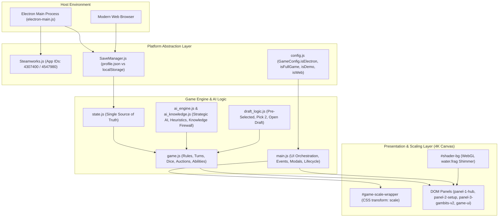
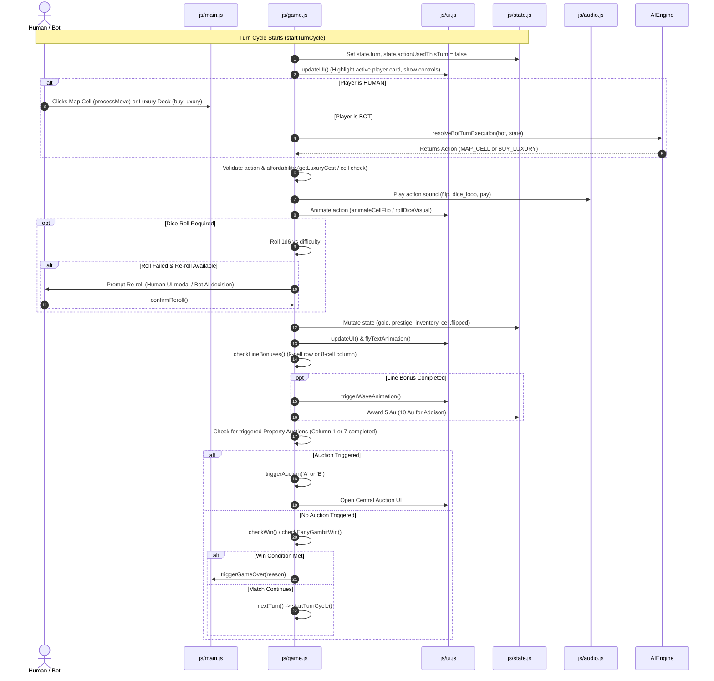

# Boca Raton: Technical Architecture

This document provides a comprehensive technical overview of the architecture, module layout, data flow, rendering pipeline, and platform abstraction layers for the *Boca Raton* (published on Steam as *Gold Coast Gambits*) codebase.

---

## 1. High-Level Architectural Overview

*Boca Raton* is built as a single-page web application packaged for desktop distribution using **Electron** and bundled with **Vite**. The game engine is implemented in pure modern **JavaScript (ES Modules)**, styled using **Tailwind CSS (v4)** and custom CSS, and supplemented with **WebGL GLSL Shaders** for dynamic background effects.

The codebase is intentionally structured with strong platform abstraction:
- **Game Engine & State Management**: 100% platform-independent pure JavaScript modules.
- **Rendering**: DOM-based card and board rendering inside a fixed-aspect 4K virtual scaling canvas, plus WebGL canvas shaders.
- **Persistence**: Abstracted via `SaveManager.js` to automatically switch between Electron native file I/O (`profile.json`) and browser `localStorage`.
- **Steam Integration**: Isolated to Electron IPC handlers and safe environment checks in `AchievementManager.js` and `electron-main.js`.
- **Editions**: Three editions share this code: Steam Full, Steam Demo and the browser-only **Web Party Edition**. `js/config.js` resolves exactly one of `isFullGame` / `isDemo` / `isWeb` at build time. Web-specific behavior sits behind `GameConfig.isWeb` and in the pure module `js/web_party.js`; see [WEB_EDITION.md](WEB_EDITION.md).



---

## 2. Directory & Component Layout

| Path | Category | Role & Description |
| :--- | :--- | :--- |
| `electron-main.js` | Electron Main | Desktop host process, window lifecycle, GPU flags, Steamworks initialization, safe external link dispatch. |
| `index.html` | Presentation Entry | Root HTML shell, 4K virtual stage containers, SVG definitions, import maps, modals. |
| `index.css` | Styling | Global layout rules, animations, V2 glass plate definitions, font styles. |
| `vite.config.ts` | Build Pipeline | Vite build configuration, asset handling (`.webp`), Tailwind CSS, GLSL plugin, build macros. |
| `electron-builder.full.json` | Packaging | Electron packaging configuration for Steam Full release (macOS/Win). |
| `electron-builder.demo.json` | Packaging | Electron packaging configuration for Steam Demo release (macOS/Win). |
| `src/shaders/water.frag` | Shaders | GLSL Fragment shader rendering the animated ocean shimmer background. |
| `js/main.js` | UI Controller | Primary application controller: auto-zoom scaling, menu transitions, event delegation, dialogs. |
| `js/game.js` | Game Engine | Authoritative gameplay logic: turn cycle, cell flips, dice rolling, auctions, line bonuses, abilities. |
| `js/state.js` | State Management | Single source of truth state object (`state`), default profiles, profile save/load triggers. |
| `js/config.js` | Platform Detection | Runtime environment flags (`isElectron`, and exactly one of `isFullGame` / `isDemo` / `isWeb`, resolved by `resolveEdition`). |
| `js/SaveManager.js` | Persistence Layer | Cross-platform save/load adapter (Electron `fs.promises` vs Web `localStorage`). |
| `js/ui.js` | DOM Renderer | DOM element generation, board grid creation, card visuals, animations (flip, fly text, dice). |
| `js/audio.js` | Audio Manager | Web Audio API / HTML5 Audio manager for multi-track BGM, title themes, and dynamic SFX. |
| `js/background.js` | WebGL Controller | Manages WebGL context, compiling `water.frag`, color themes, and context loss/restore handlers. |
| `js/data.js` | Data Constants | Board dimensions, property cards, luxury cards list, sprite asset paths, audio registries. |
| `js/characters.js` | Game Content | The 10 playable Local characters, starting stats, abilities, and lore. |
| `js/bots.js` | Game Content | The 10 Visitor bot profiles, intelligence tiers, personalities, and starting re-rolls. |
| `js/landmarks.js` | Game Content | The 10 Palm Beach and Boca Raton historical landmarks, locations, and cash bonuses. |
| `js/gambit_data.js` | Game Content | The 50 campaign Gambits, objectives, setups, victory conditions, and unlock rewards. |
| `js/draft_logic.js` | Draft Logic | Pure logic routines for character selection, Pick 2 (PAIR) candidate handling (with optional Web recycling of unpicked cards) and the Random draft pool. |
| `js/web_party.js` | Web Edition Logic | Pure, unit-tested rules of the Web Party Edition: 2-4 player clamp, party config, default names, tutorial chain, board centering, keyboard guard, small-window hint, tap-to-preview detection. |
| `js/unlock_data.js` | Unlocks Data | Unlock thresholds for board variations (Spanish, Red Reef, Mizner) and draft modes. |
| `js/UnlockManager.js` | Unlocks Engine | Progression and feature-gating verification logic (Demo locks vs Full game unlocks). |
| `js/AchievementManager.js`| Achievements | Achievement condition checker, local achievement array, and Steamworks IPC notification. |
| `js/ai_knowledge.js` | AI Knowledge | Sanitized knowledge state constructor enforcing hidden information firewall for bots. |
| `js/ai_engine.js` | AI Strategy | Strategic heuristic evaluation engine for bot bidding, luxury purchasing, map flips, and re-rolls. |
| `js/debug.js` | Dev Utilities | Debugging commands, state inspectors, god mode hooks, AI telemetry loggers. |
| `js/StatsUI.js` | UI Components | High score and player career statistics display panel. |
| `js/tutorial.js` | Tutorial Engine (legacy) | Older tutorial manager. Nothing starts it any more; only `handleInteractionSuccess` is still called from `game.js`. The lessons for Gambits 1-4 that actually run are in `js/ui.js` (`runTutorialStep` and the `showG*` popups). |
| `js/exit_promo.js` | Demo Promo | Content and links for Demo exit modal (Kickstarter & Steam Full wishlist). |
| `js/start_menu_pop_up.js`| Demo Promo | Content and links for Demo start screen banner. |
| `public/assets/` | Static Assets | WebP spritesheets, textures, UI graphics, and AAC/MP3 audio files. |

---

## 3. Platform Independence vs Steam/Electron Dependencies

The codebase cleanly isolates platform-dependent code from gameplay systems:

```
+-------------------------------------------------------------------------+
|                  PLATFORM-INDEPENDENT (Core Game Engine)               |
|                                                                         |
|  - js/game.js (All gameplay rules, turn cycles, dice, auctions)         |
|  - js/state.js (State structure, profile structures)                    |
|  - js/ui.js (DOM manipulation, animations, card rendering)              |
|  - js/ai_engine.js & ai_knowledge.js (AI reasoning and decisions)       |
|  - js/data.js, characters.js, bots.js, landmarks.js, gambit_data.js     |
|  - js/draft_logic.js, unlock_data.js, UnlockManager.js                  |
|  - js/audio.js (Web Audio API / HTML5 Audio)                            |
|  - js/background.js & src/shaders/water.frag (Standard WebGL)           |
+-------------------------------------------------------------------------+
                                    |
          +-------------------------+-------------------------+
          |                                                   |
+-----------------------------------+   +---------------------------------+
|   STEAM / ELECTRON SPECIFIC       |   |       BROWSER FALLBACKS         |
|                                   |   |                                 |
| - electron-main.js (Main process) |   | - SaveManager.js: localStorage  |
| - steamworks.js integration       |   | - AchievementManager.js: local  |
| - SaveManager.js: fs/path/userData|   | - External links: window.open   |
| - IPC handlers: steam:unlock-...  |   | - GameConfig.isElectron = false |
| - Ticker canvas (#steam-overlay)  |   |                                 |
+-----------------------------------+   +---------------------------------+
```

### Specific Integration Touchpoints:

1. **Steamworks SDK (`steamworks.js`)**:
   - Initialized exclusively in `electron-main.js` via `steamworks.init(steamAppId)` before BrowserWindow creation.
   - Renderer communicates with Steam exclusively through safe asynchronous IPC calls (`ipcRenderer.send('steam:unlock-achievement', id)` and `ipcRenderer.send('open-discord-overlay', url)`).
   - If `window.require` is undefined (such as in a standard web browser), `AchievementManager.js` skips the IPC call without throwing errors.

2. **Persistence (`SaveManager.js`)**:
   - Checks `typeof window.require !== 'undefined'`.
   - **Electron**: Calls `ipcRenderer.invoke('app:get-path', 'userData')` to resolve the unified directory (`boca-raton-save/profile.json`) and reads/writes via Node `fs.promises`.
   - **Browser**: Reads and writes JSON strings directly using `window.localStorage.getItem(SAVE_KEY)` and `setItem`. `SAVE_KEY` comes from `getSaveKey()`: `bocaRatonSaveGame` for every edition except the Web edition, which uses its own key `bocaRatonWebSave` (and its hard wipe removes only its own keys).

3. **External Links**:
   - In Electron, all web links (Kickstarter, Steam Store, Discord) are routed through `openExternalDetached(url)`, spawning a detached OS process (`cmd.exe /c start`, `open`, or `xdg-open`) without child process references.
   - In a browser, standard HTML anchor tags or `window.open(url, '_blank')` operate natively.

4. **Web Party Edition** (`GameConfig.isWeb`):
   - Hides the Steam-only pieces (Quit, Discord, wishlist, Kickstarter and Steam promos, the Steam overlay ticker) with the marker classes `.steam-only` / `.hide-on-web` under `html.edition-web`, and skips the promo modals in `showPromoModal` / `showStartPromoModal`.
   - Replaces the hub with a single party menu (`goToMainHub` redirects to `goToSetupV2`).
   - Full list of differences and the code map: [WEB_EDITION.md](WEB_EDITION.md).

---

## 4. UI Architecture & The 4K Virtual Canvas Constraint

### The Continuous Scaling Engine

To maintain high visual fidelity on displays ranging from 1080p laptops to 4K monitors and mobile screens without breaking card grids or reflowing text, *Boca Raton* implements a **4K Virtual Canvas Scaling System**:

1. **Virtual Resolution**: All game screens, panels, buttons, grids, text boxes, and card views are authored relative to a fixed virtual canvas:
   - **Width**: `3840px`
   - **Height**: `2160px`
2. **Contain Scaling Algorithm**:
   - In `js/main.js`, `initAutoZoom()` measures the browser viewport (`window.innerWidth` and `window.innerHeight`) on load and on every resize (debounced by 100 ms). Electron uses the same CSS scaling; `configureGameWindow()` no longer scales anything (its native-zoom code is commented out, it only logs a message).
   - There is **no minimum width**: the old "Window Too Narrow" curtain (`#resolution-curtain`) is dead code that is hidden on every resize. The zoom is never below 0.1.
   - It computes:
     $$\text{zoomFactor} = \max\left(0.1, \min\left(\frac{\text{viewportWidth}}{3840}, \frac{\text{viewportHeight}}{2160}\right)\right)$$
   - `app.setBoardZoom(zoom)` applies `transform: scale(zoomFactor)` to the screen wrappers: `#board-wrapper` (in-game board, `origin-top`), `#ui-v2-content` (menus, `origin-center`) and the modal / gallery / draft wrappers. There is no `#game-scale-wrapper` element; the code that looks for it finds nothing.
   - Menus are centered in the window. The in-game board is pinned to the top on Steam; on the **Web edition** it is centered vertically with an extra `translateY` (`webBoardOffsetY`).
3. **Absolute Coordinates Rule**:
   - **Crucial Rule**: All elements inside game panels (`panel-1-hub`, `panel-2-setup`, `panel-3-gambits-v2`, `game-ui`) must use **absolute positioning** (`position: absolute; top: ...px; left: ...px; width: ...px; height: ...px;`) with fixed pixel units.
   - **Reason**: Flexbox reflow and auto-wrapping cause catastrophic layout breaks when viewport dimensions change. Under uniform CSS scale transforms, absolute pixel positioning guarantees pixel-perfect rendering across all screen sizes.

---

## 5. State Management & Data Flow

### The Single State Store (`js/state.js`)

All runtime game state is unified in the exported `state` singleton:
- `state.turn`: Index of the currently active player (0 to `players.length - 1`).
- `state.players`: Array of player objects (containing `id`, `name`, `type: 'HUMAN'|'BOT'`, `character`, `botId`, `gold`, `prestige`, `inventory`, `rerolls`, `extraTurns`, `status`).
- `state.grid`: 72-cell array representing the 8×9 board.
- `state.auctions`: State of Auction A (Waterfront Left) and Auction B (Waterfront Right).
- `state.luxuryDecks`: 3 luxury decks (Costs: 5, 10, 15 Au).
- `state.mode`: Current game mode (`'HUB'`, `'SETUP'`, `'GAMBITS'`, `'GAME'`, `'AUCTION'`, `'TUTORIAL'`, `'GAME_OVER'`).
- `state.playerProfile`: Persistent campaign unlocks (`clearedGambits`, `unlockedCharacters`, `unlockedBots`).
- `state.stats`: High scores, career prestige, games won/lost, achievement progress.
- `state.settings`: Audio volumes, animation speeds, bot pacing, display preferences.

### Execution Cycle (Turn Data Flow)



---

## 6. AI Engine Architecture (`js/ai_knowledge.js` & `js/ai_engine.js`)

The AI architecture is engineered to provide authentic human-like decision making without cheating:

1. **Knowledge Firewall (`buildBotKnowledgeState`)**:
   - The AI engine does NOT inspect raw `state` directly.
   - `buildBotKnowledgeState(state, bot)` creates a sanitized knowledge snapshot that filters out hidden information:
     - Hidden face-down map card identities are masked.
     - Bot money is sanitized if the "Hidden Bot Money" rule is enabled.
     - Luxury deck card details remain hidden if the deck is closed.
2. **Strategic Context Analyzer (`analyzeStrategicContext`)**:
   - Computes dynamic game phase (Early, Mid, Endgame).
   - Evaluates player prestige pace and tracks the leader.
   - Calculates the **Post-Auction Minimum Reserve** to prevent bots from going bankrupt before vital property auctions.
   - Evaluates **Mar-a-Lago Tiebreak Premium** when bidding.
3. **Action Evaluator (`evaluateTurnActions`)**:
   - Compares expected values (in Au and Prestige equivalents) between picking map cells vs attempting luxury purchases.
   - Evaluates risk vs reward on dice checks using true mathematical probability models.
   - Dispatches choices through individual Visitor bot personality profiles (Goober, Superboy, Surfer Dude, Boss Cat, Robot, Pirate, Flamingo Queen, Magician, The Twins, Gran Gran).
