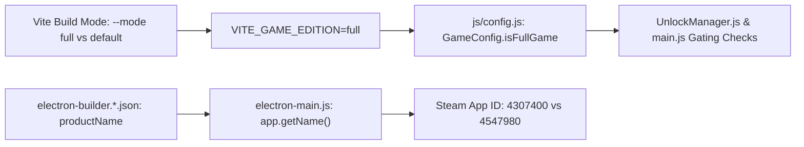

# Boca Raton: Steam Full vs Demo Architecture

This document details the configuration, feature gating, promotional systems, Steamworks integration, and build pipelines for the **Steam Full** and **Steam Demo** releases of the game (published on Steam under the product title **Gold Coast Gambits**).

---

## 1. App ID & Depot Reference

Both editions are managed under Backhans Games' Steamworks partner account:

| Attribute | 🔵 Full Version | 🟢 Demo Version |
| :--- | :--- | :--- |
| **Product Title** | **Gold Coast Gambits** | **Gold Coast Gambits Demo** |
| **Steam App ID** | `4307400` | `4547980` |
| **Windows Depot ID** | `4307401` | `4547981` |
| **macOS Depot ID** | `4307402` | `4547982` |
| **macOS App Bundle** | `Gold Coast Gambits.app` | `Gold Coast Gambits Demo.app` |
| **Windows Executable** | `Gold Coast Gambits.exe` | `Gold Coast Gambits Demo.exe` |
| **Electron App ID** | `com.bocaraton.game` | `com.bocaraton.game.demo` |
| **Build Config File** | `electron-builder.full.json` | `electron-builder.demo.json` |
| **Build Output Directory** | `dist/full-game` | `dist/demo-game` |
| **Store Page URL** | [Steam Store (4307400)](https://store.steampowered.com/app/4307400/Gold_Coast_Gambits_Boca_Raton__Palm_Beach/) | Free Demo on same store hub |

---

## 2. Single-Codebase Architecture

The Full and Demo versions are **NOT** maintained in separate repositories, separate branches, or separate source folders. They share 100% of the game engine, UI code, assets, and shaders on the `main` branch.

### How Edition Switching Works:



1. **Build Time**:
   - `vite build` (Default): Sets `import.meta.env.VITE_GAME_EDITION` to `undefined`, triggering Demo mode.
   - `vite build --mode full`: Loads `.env.full`, setting `VITE_GAME_EDITION=full`.
2. **Runtime Code Configuration (`js/config.js`)**:
   ```javascript
   export function resolveEdition(edition) {
       return {
           isFullGame: edition === 'full',
           isWeb: edition === 'web',
           isDemo: edition !== 'full' && edition !== 'web'
       };
   }

   export const GameConfig = {
       isElectron: typeof navigator !== 'undefined' && (
           navigator.userAgent.toLowerCase().indexOf(' electron/') > -1 || 
           !!(window.process && window.process.versions && window.process.versions.electron) ||
           !!(window.require && window.require('electron'))
       ),
       isFullGame: /* resolveEdition(...).isFullGame */,
       isDemo: /* resolveEdition(...).isDemo */,
       isWeb: /* resolveEdition(...).isWeb */   // Web Party Edition, never true in a Steam build
   };
   ```
   For the two Steam editions the result is exactly the same as before the Web edition existed: no edition setting means Demo, `full` means Full. The third value, `web`, belongs to the browser-only [Web Party Edition](WEB_EDITION.md), which has no Steam App ID, no depots and no Steamworks code.
3. **Electron Main Process App ID Resolution (`electron-main.js`)**:
   ```javascript
   let steamAppId = 4307400; // Default Full
   if (app.getName().toLowerCase().includes('demo')) {
       steamAppId = 4547980; // Demo
   }
   process.env.SteamAppId = steamAppId.toString();
   process.env.STEAM_APP_ID = steamAppId.toString();
   ```
4. **Unified Save System**:
   To ensure players who upgrade from the Demo to the Full game retain their campaign progress, settings, and high scores, `electron-main.js` forces a unified save folder:
   ```javascript
   const unifiedUserDataPath = join(app.getPath('appData'), 'boca-raton-save');
   app.setPath('userData', unifiedUserDataPath);
   ```

---

## 3. Feature Restrictions in the Demo

When `GameConfig.isDemo === true`, specific feature gates are actively enforced:

| Feature / System | 🔵 Full Version | 🟢 Demo Version Restriction | Enforcing File |
| :--- | :--- | :--- | :--- |
| **Campaign Levels** | Levels 1 through 10 (all 50 Gambits) | **Levels 1 to 4 only (Gambits 1 to 20)**. Selecting levels > 4 opens the Promo Modal. | `js/main.js`, `js/UnlockManager.js` |
| **Character Drafting**| Pre-Selected, Pick 2 (Pair), Open Draft | **Pick 2 (Pair) blocked** in custom matches; permitted only during Gambits 10 & 15. | `js/draft_logic.js` |
| **Game Variations** | All 4 (Standard, Spanish, Red Reef, Mizner) | **Mizner Variation locked** in custom match. | `js/main.js` |
| **Tournament Mode** | Available | **Locked**; opens Promo Modal. | `js/main.js` |
| **Player Count** | 2 to 4 players | **Max 4 players** (player counts > 4 gated). | `js/main.js` |
| **Unlock Lock Text** | Shows `GAMBIT {N}` | Replaced with `"FULL GAME"` badge. | `js/ui.js` |

---

## 4. Advertising & In-Game Promotion

The Demo incorporates non-intrusive promotional triggers designed to convert demo players into Steam wishlists and Kickstarter backers:

1. **Exit Promotion (`js/exit_promo.js`)**:
   - Triggered when the player attempts to quit the application in Demo mode.
   - Headline: *"ENJOYING THE DEMO?"*
   - Copy: Explains that Backhans Games is an indie team and prompts for a free Steam Wishlist.
   - Direct buttons:
     - **Wishlist on Steam**: Directs to [Steam Full Game Hub](https://store.steampowered.com/app/4307400/Gold_Coast_Gambits_Boca_Raton__Palm_Beach/).
     - **Kickstarter**: Directs to [Backhans Kickstarter Campaign](https://www.kickstarter.com/projects/backhansgames/boca-raton-and-palm-beach).
2. **Start Screen Promo (`js/start_menu_pop_up.js`)**:
   - Subtle banner on the main menu reminding players that the full version is launching soon with a launch discount.
3. **Interactive Locked Element Modals (`app.showPromoModal`)**:
   - Clicking any locked campaign level (> 4), locked character, or locked variation in the Demo opens a sleek glass modal detailing the Full Game's additional content and a one-click Steam store link.

---

## 5. Steamworks Integration (`steamworks.js`)

Steam integration is powered by `steamworks.js` (v0.4.0) inside Electron:

### 5.1 Steam Overlay Hooking
Chromium inside Electron often throttles background rendering or disables hardware composition hooks that the native Steam Overlay needs. To guarantee the Steam Overlay displays reliably at 60 FPS:
- **GPU Switches (`electron-main.js`)**:
  ```javascript
  app.commandLine.appendSwitch('in-process-gpu');
  app.commandLine.appendSwitch('disable-direct-composition');
  app.commandLine.appendSwitch('disable-renderer-backgrounding');
  app.commandLine.appendSwitch('disable-features', 'CalculateNativeWinOcclusion');
  ```
- **Ticker Canvas (`index.html`)**: A hidden 1×1 canvas `#steam-overlay-canvas` continuously renders an animation loop to force continuous Chromium texture buffer invalidation so Steam Overlay input and rendering never stall.

### 5.2 Achievements
Over 25 achievements are registered in `js/AchievementManager.js`.
- During gameplay, condition triggers call `AchievementManager.unlock(id)`.
- If running under Electron, it invokes:
  ```javascript
  ipcRenderer.send('steam:unlock-achievement', ach.id);
  ```
- `electron-main.js` dispatches this to native Steamworks:
  ```javascript
  steamClient.achievement.activate(achievementId);
  ```
- On game boot, `AchievementManager.syncWithSteam()` synchronizes any locally stored achievements with Steam.

### 5.3 Steam Overlay Web Browser
Links to the game's official Discord are opened directly inside the in-game Steam Overlay rather than kicking players out to an external OS browser:
```javascript
ipcMain.on('open-discord-overlay', (event, url) => {
  if (steamClient && steamClient.overlay) {
    steamClient.overlay.activateToWebPage(url);
  } else {
    openExternalDetached(url);
  }
});
```

---

## 6. Build and Publishing Pipeline

### 6.1 Package Scripts (`package.json`)
- **Demo Windows**: `npm run build:demo:win` (`vite build && electron-builder --win --x64 -c.directories.output=dist/demo-game`)
- **Demo macOS**: `npm run build:demo:mac` (`vite build && electron-builder --mac --config electron-builder.demo.json`)
- **Full Windows**: `npm run build:full:win` (`vite build --mode full && electron-builder --win --x64 -c.directories.output=dist/full-game`)
- **Full macOS**: `npm run build:full:mac` (`vite build --mode full && electron-builder --mac --config electron-builder.full.json`)

### 6.2 Automated Shell Scripts
- **macOS Build, Notarization & Steam Upload (`publish_mac.sh [demo|full]`)**:
  1. Validates Apple credentials and Steam credentials from `.env`.
  2. Runs the edition-specific build command.
  3. Codesigns the `.app` bundle with Apple Developer ID.
  4. Submits the zip archive to Apple's Notary service (`xcrun notarytool submit`).
  5. Staples the notarization ticket to the application (`xcrun stapler staple`).
  6. Generates Steam VDF configuration files dynamically from templates in `steam/`.
  7. Executes SteamCMD to deploy the depot to SteamPipe.
- **Windows Build from Mac / Git Bash (`publish_win.sh [demo|full]`)**:
  1. Runs the Windows Electron build.
  2. Generates Windows depot VDF files.
  3. Uploads the Windows depot via SteamCMD.
