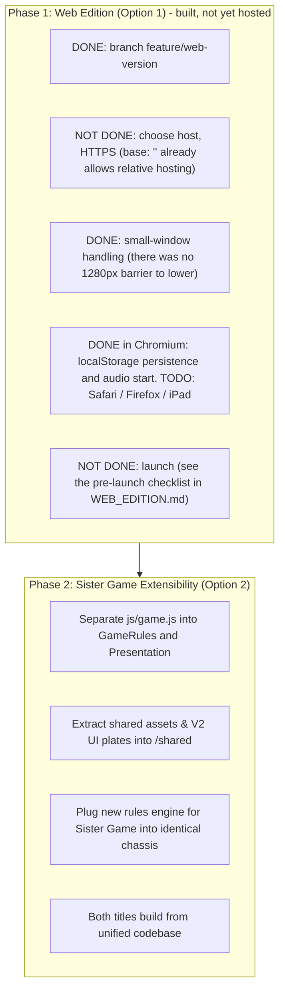

# Boca Raton: Web Migration & Sister Game Strategy

This document provides an objective, evidence-based architectural analysis of three pathways to deploy *Boca Raton* to the web and extend the platform for a future sister title featuring different gameplay rules.

> **Status update:** **Option 1 was chosen and implemented** as a separate **Web Party Edition** (2-4 players on one screen) on the branch `feature/web-version`. It is hosted on Netlify at https://bocaraton.backhansgames.com (manual uploads of `dist-web/`). What was built, how it works, what is verified and the pre-launch checklist are in [WEB_EDITION.md](WEB_EDITION.md). Phase 2 (the sister game / shared chassis) has **not** been started. Where this analysis was written before the code was checked, corrections are marked "*(corrected)*" below.

---

## 1. Baseline Assessment of Current Codebase

An investigation of the existing codebase reveals that **the game already supports browser execution**:

1. **Vite Web Architecture**: The project is already an ES Modules web application bundled via Vite (`vite.config.ts`).
2. **Environment Abstraction**: `js/config.js` dynamically checks `isElectron`. If running in a browser, `isElectron` safely evaluates to `false`.
3. **Persistence Layer**: `js/SaveManager.js` already includes native `localStorage` support for profile saving and loading whenever Electron is absent.
4. **Vite Assets**: `vite.config.ts` specifies `base: ''` to support relative root hosting (e.g. Netlify, Vercel, GitHub Pages).
5. **No Native Binaries in Frontend**: `steamworks.js` is exclusively loaded in the Node.js main process (`electron-main.js`). The renderer UI is pure HTML5, CSS, and WebGL.

### Current Web Limitations to Address:
- **Resolution Cutoff** *(corrected)*: There is **no** width barrier. The "Window Too Narrow" curtain is dead code (hidden on every resize) and the scaling engine scales to any size. The real limit is legibility: about 1024 px wide and up is comfortable, phones are too small. The Web edition adds a dismissible small-window / rotate notice, centers the board vertically and ignores keyboard-driven resizes while a name is typed.
- **Touch Controls** *(done)*: Taps work through ordinary click handlers. The hover-only card enlargement in Open Draft now has a tap-to-preview replacement on touch screens (Web only). Other hover effects are cosmetic.
- **Autoplay Audio Policy** *(checked in Chromium)*: Audio starts after the first click (the splash screen's Start button) and plays normally in the Chromium browser that was used. Safari on macOS and iPadOS still needs testing.

---

## 2. Evaluation of the Three Migration Options

### Option 1: Direct Export of Existing Game to the Browser
Deploy the current Vite web build directly to static web hosting (Netlify, Vercel, Cloudflare Pages, AWS S3).

- **Complexity**: **Very Low**. Run `npm run build` (or `npm run build --mode full`), upload the `dist/` folder.
- **Code Reuse**: **100%**. Reuses all existing game logic, UI, animations, assets, and shaders.
- **Risks** *(corrected)*: No width barrier exists; phones are simply too small to play comfortably. Steam-specific wording and promos in the existing Demo build also need to be hidden, which is why a separate Web edition setting was added rather than reusing the Demo build.
- **Maintainability**: High for desktop web and tablets; maintenance overhead is near zero.
- **Suitability for Future Sister Game**: **Low**. Game rules, grid layout, and UI remain coupled.

### Option 2: Decoupled Core Logic with Shared Assets & Modular Frontend
Refactor the architecture to extract core game primitives (`Card`, `Deck`, `Player`, `AuctionEngine`, `DiceSystem`) into a headless rules engine (`@boca/engine`), allowing *Boca Raton* and the future *Sister Game* to share identical assets, rendering pipelines, and UI plates while implementing divergent gameplay rulebooks.

- **Complexity**: **Moderate**. Requires separating `js/game.js` into stateful rule modules and a presentation interface.
- **Code Reuse**: **Very High**. Graphical spritesheets, audio manager, shader background, V2 glass panels, and AI heuristics are completely preserved and reused.
- **Risks**: Low, provided regression test suites are executed during logic extraction.
- **Maintainability**: **Excellent**. Fixes in shared assets or AI heuristics instantly benefit both games.
- **Suitability for Future Sister Game**: **Optimal**. The exact design goal: new game rules plug into the existing visual and component chassis.

### Option 3: Full Reimplementation for the Web
Rewrite the game from scratch in an alternative engine (such as PixiJS, Phaser, Unity WebGL, or a React/Vue framework).

- **Complexity**: **Extremely High**. Requires rewriting over 15,000 lines of verified gameplay logic, campaign systems, and bot AI.
- **Code Reuse**: **Low**. Only static raw art assets and sound clips could be reused; all layout and behavior must be rebuilt.
- **Risks**: **Severe**. Massive risk of regression, loss of nuanced AI bot behaviors, high budget, and prolonged timeline.
- **Suitability for Future Sister Game**: High once built, but with disproportionate initial cost.

---

## 3. Comparison Matrix

| Factor | Option 1: Direct Export | Option 2: Decoupled Logic & Shared Chassis | Option 3: Full Reimplementation |
| :--- | :---: | :---: | :---: |
| **Effort to Web Launch** | **Immediate (1–2 days)** | Moderate (2–3 weeks) | High (2–4 months) |
| **Code Reuse** | **100%** | **85%–90%** | 20% (assets only) |
| **Regression Risk** | **None** | Low (guarded by tests) | Severe |
| **Mobile / Tablet Friendliness** | Tablets in landscape (about 1024 px wide and up); not phones | Full (responsive adaptations) | Full |
| **Sister Game Readiness** | Unprepared | **Perfect Architectural Fit** | Overkill |
| **Development Cost** | Minimal | Low / Phased | Very High |

---

## 4. Definitive Recommendation: The Two-Phase Migration

Based on the actual state of the codebase, **Option 3 should be firmly rejected**. The current codebase is already 95% web-ready and contains mature, tested game logic.

### Recommended Phased Roadmap:

### Where things stand and what comes next
1. **Done:** the Web edition is built with its own edition setting, build commands (`npm run dev:web`, `build:web`, `preview:web`, output in `dist-web/`) and tests. See [WEB_EDITION.md](WEB_EDITION.md).
2. **Next:** test on Safari, Firefox and a real iPad; the product owner launches the Steam builds in Electron to confirm nothing changed; complete the credential cleanup; then decide on hosting and on merging `feature/web-version` into `main` through a pull request.
3. **Later (Phase 2):** the sister game. The Web edition already keeps its new logic in a small pure module (`js/web_party.js`), which is a useful pattern for separating rules from presentation.
